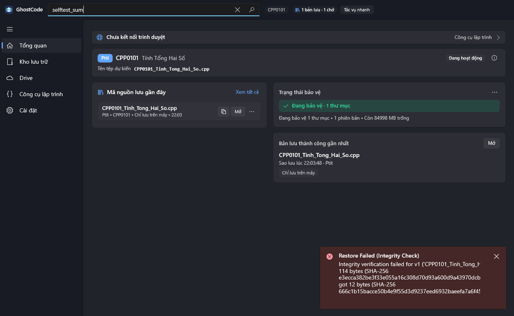
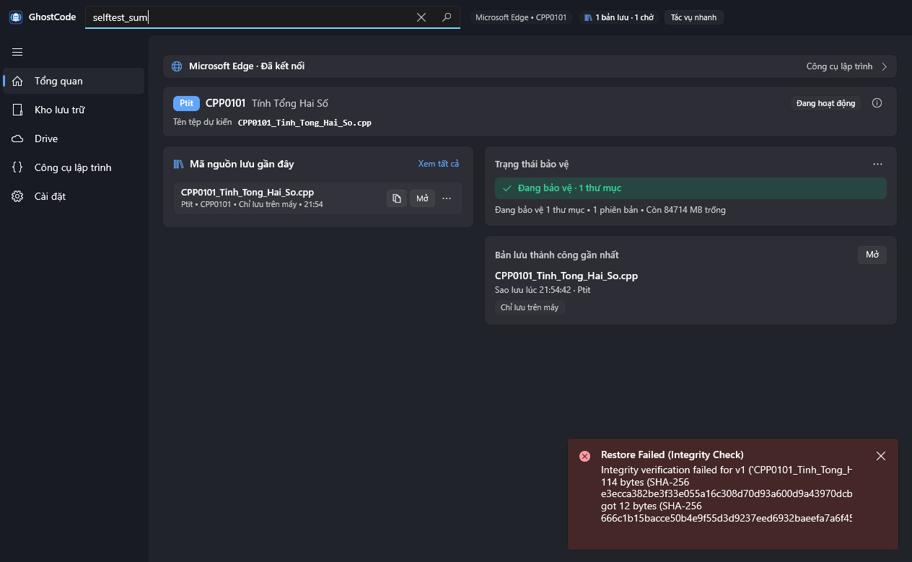
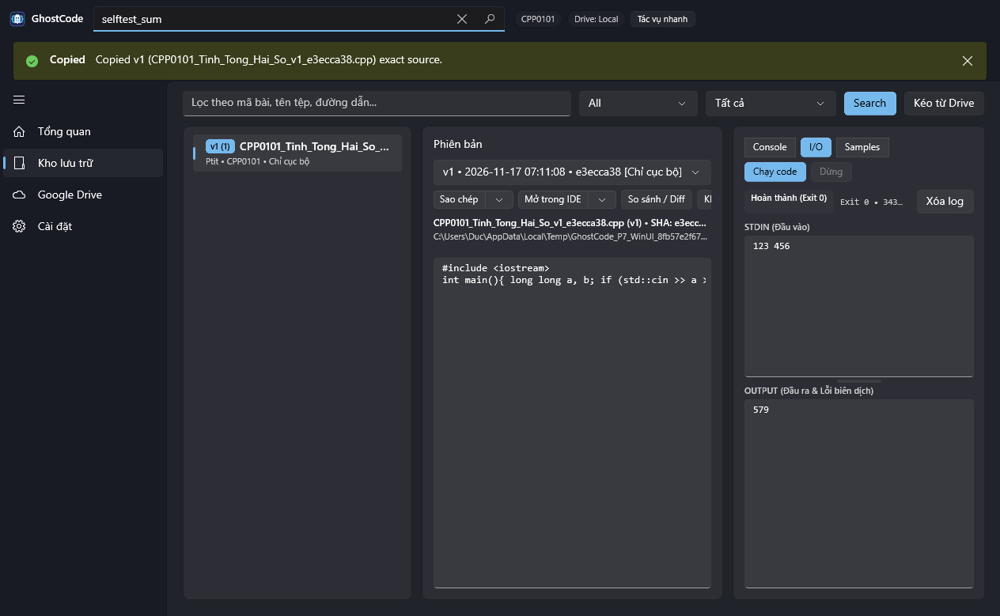
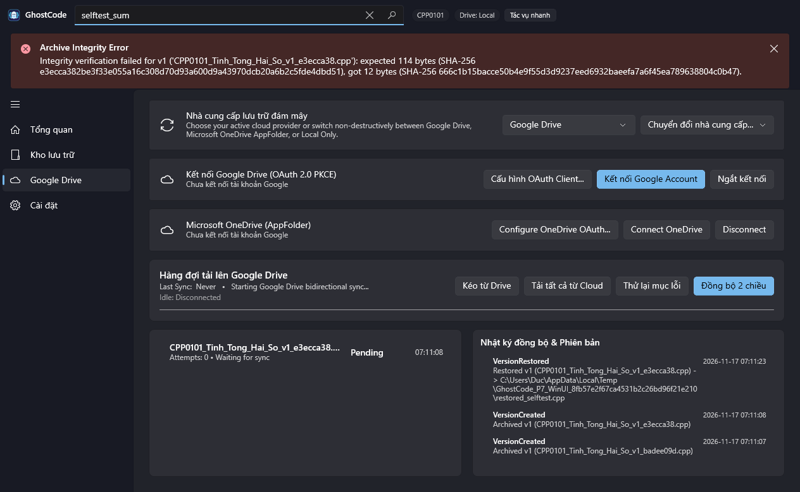
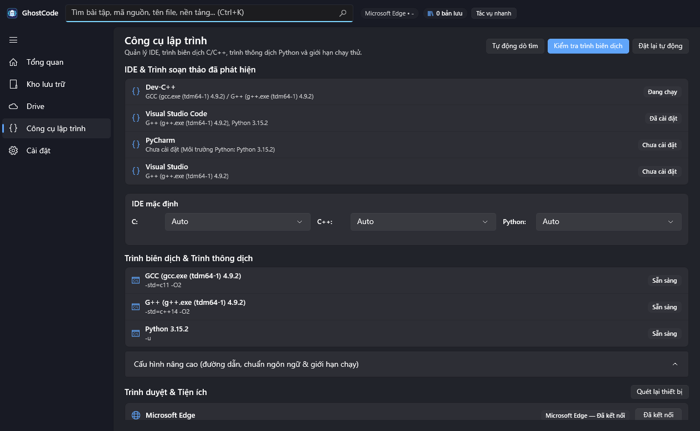
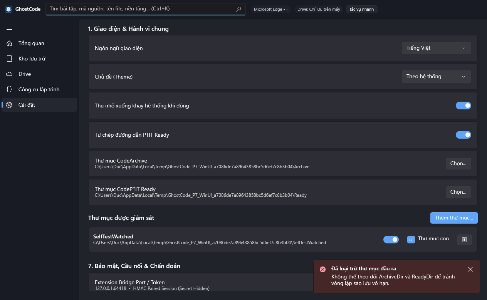

# GhostCode

[](LICENSE)

**Native Windows 10/11 (x64) WinUI 3 companion for automatic local-first source-code preservation, active problem detection, built-in compilation & test execution, and cloud archive sync.**



---

## Core Capabilities

- **Local-First Automatic Archiving**: Continuously watches your configured coding folders, snapshots every meaningful edit cleanly into `%USERPROFILE%\Documents\GhostCode` (or a custom folder) with immutable SQLite-indexed version history, and **never modifies or deletes your original source files**.
- **Problem Context Detection**: Pairs with the bundled Manifest V3 Chromium extension (`v1.4.0`, supporting **Microsoft Edge**, **Google Chrome**, and **Thorium**) and Firefox extension via Windows Native Messaging (`com.ghostcode.bridge`) to detect active problems on **Code PTIT**, **Codeforces**, **VNOJ**, **LeetCode**, and **HackerRank** and organize backups with clean problem-aware names.
- **Built-In Code Runner & Development Tools**: Inspect version timelines, compare diffs, compile and execute C / C++ / Python solutions against sample or custom test cases directly inside the app, and manage detected IDEs and compilers cleanly.
- **Optional Cloud Synchronization**: Sync pending and pulled archives with **Google Drive** (OAuth 2.0 + PKCE) or **OneDrive** (Microsoft Graph Device Code), with encrypted DPAPI token storage (`%LOCALAPPDATA%\GhostCode`) and resilient local queueing when offline or misconfigured.
- **Bilingual Native UI**: Full **Tiếng Việt** and **English** localization with Light and Dark Windows 11/10 WinUI 3 themes.

---

## System Requirements

- **OS**: Windows 10 version 2004 (Build 19041) or newer, or Windows 11 (**x64**)
- **Runtime**: **None required** — both official release downloads are `self-contained win-x64` packages bundling .NET 10 and Windows App SDK.

---

## Installation

Download the latest release assets from the [GitHub Releases](https://github.com/trungduc22/GhostCode/releases) page and verify integrity against `SHA256SUMS.txt`.

### Option 1 — Windows Installer (`GhostCode-Setup-x64.exe`, Recommended)
1. Run `GhostCode-Setup-x64.exe`.
2. Installs per-user into `%LOCALAPPDATA%\Programs\GhostCode` (no administrator UAC prompt required).
3. Creates a Start Menu shortcut (optional Desktop shortcut), registers Native Messaging hosts in `HKCU` for **Chrome**, **Edge**, **Thorium**, and **Firefox**, and upgrades cleanly over earlier versions without touching your existing archives or settings.
4. Uninstalling removes application binaries and `HKCU` Native Messaging registry entries while **preserving `%LOCALAPPDATA%\GhostCode` (settings, SQLite database) and your archived source files**.

### Option 2 — Portable Edition (`GhostCode-Portable-win-x64.zip`)
1. Extract the ZIP to any folder (e.g. `D:\Tools\GhostCode`).
2. Run `GhostCode.App.exe`.
3. Bundled `browser-extension\` and `browser-extension-firefox\` folders can be loaded directly or connected from the **Browsers / Công cụ phát triển** page.

---

## Setting Up Google Drive Sync

GhostCode uses your own **Desktop app** Google OAuth 2.0 Client ID so you keep full control over your Google Cloud quota and permissions.

1. Open [Google Cloud Console](https://console.cloud.google.com/) and select (or create) a project.
2. **Enable Google Drive API (`drive.googleapis.com`)** in that **same project** under **APIs & Services → Enabled APIs & services**.
3. Configure the **OAuth consent screen**:
   - While the app status is **Testing**, add your Google email address under **Audience → Test users** (up to 100 test users; OAuth refresh tokens issued in Testing mode expire after 7 days until published).
4. Under **Clients → Create Client**, choose application type **Desktop app** and copy the **Client ID** (and optional Client Secret if created for an older client).
5. Paste the Client ID in GhostCode (**Cloud → Google Drive**) and sign in via browser PKCE.

### Troubleshooting `SERVICE_DISABLED` / HTTP 403
- If Cloud Sync displays **"Google Drive API chưa được kích hoạt"** (`CloudApiDisabled`), the Google Cloud project owning your OAuth Client ID (`projects/<project_number>`) does not have `drive.googleapis.com` enabled yet.
- GhostCode automatically **pauses rapid retry loops**, preserves every pending item in your local `upload_queue`, validates your Client ID project number, and provides a direct **"Bật Google Drive API"** button opening the official Google Cloud Console activation link. Once enabled, click **"Thử lại"** to resume syncing immediately.

---

## Screenshots

| Dashboard (Light) | Dashboard (Dark) |
|---|---|
|  |  |

| Archive & Runner | Cloud Sync |
|---|---|
|  |  |

| Development Tools | Settings |
|---|---|
|  |  |

---

## Building & Packaging From Source

Prerequisites: **.NET 10 SDK** (`x64`) and **Inno Setup 6** (optional, required for compiling `GhostCode-Setup-x64.exe`).

```powershell
# Restore & build Release x64
dotnet build GhostCode.sln -c Release -p:Platform=x64 -warnaserror

# Run automated unit & integration tests (CI / headless-safe)
dotnet test GhostCode.sln -c Release -p:Platform=x64 --no-build --filter "FullyQualifiedName!~Phase7WinUiFunctionalTests"

# Run full test suite including interactive WinUI 3 UI test (Windows desktop session)
dotnet test GhostCode.sln -c Release -p:Platform=x64 --no-build

# Produce Portable ZIP + Setup EXE + SHA256SUMS.txt under artifacts\Release\
pwsh -NoProfile -ExecutionPolicy Bypass -File packaging/Build-PortableBundle.ps1 -Version "0.1.0-beta.1"
```

See [docs/ARCHITECTURE.md](docs/ARCHITECTURE.md) for a module-by-module overview of the solution, storage model, browser bridge, and cloud providers.

---

## Contributing

Contributions are welcome via Pull Requests against `main`. Before submitting changes:
1. Build cleanly with warnings as errors (`dotnet build GhostCode.sln -c Release -p:Platform=x64 -warnaserror`).
2. Run the automated test suite (`dotnet test GhostCode.sln -c Release -p:Platform=x64`) and keep existing database migrations and user data preservation intact.

---

## License

GhostCode is licensed under the **MIT License** — see [LICENSE](LICENSE) for full terms.

Third-party libraries and redistributable runtimes remain under their own respective licenses; see [THIRD_PARTY_NOTICES.md](THIRD_PARTY_NOTICES.md) for attribution details.

---

## Known Limitations (`0.1.0-beta.1`)

- Windows 10/11 `x64` only.
- Community beta binaries are not yet Authenticode-signed with a commercial EV certificate; Windows SmartScreen may prompt for confirmation on first launch until reputation builds (always verify against `SHA256SUMS.txt`).
- Google Drive sync requires enabling `drive.googleapis.com` in the Google Cloud project matching your OAuth Client ID, and Testing-mode Google OAuth apps require listing your account under Test users.
- Competitive programming auto-detection focuses on **Code PTIT**, **Codeforces**, **VNOJ**, **LeetCode**, and **HackerRank**.
