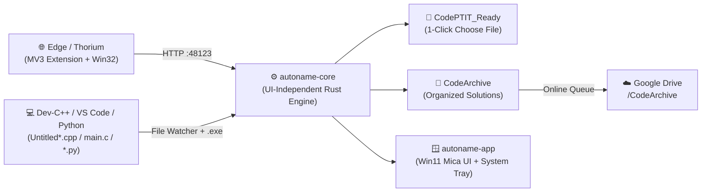

# ⚡ GhostCode — Zero-Effort Hot Archiver & Smart Namer

> **Never lose another `Untitled1.cpp` solution again.**  
> Tự động cứu code, đặt tên chuẩn `<Mã_Bài>_<Tên_Bài>` từ trình duyệt (Code PTIT, Codeforces, VNOJ, LeetCode, HackerRank), và đồng bộ lên Google Drive khi có mạng — viết thuần bằng **Rust** với giao diện **Windows 11 Mica** chạy ngầm dưới System Tray (~10 MB RAM).

---

## ✨ Tính năng nổi bật / Key Features

- **🔥 Hot-Backup & Chống mất bài khi code đè `Untitled*`**:
  - Theo dõi thư mục code (`Dev-C++`, `VS Code`, `Python`), phát hiện lưu (`Ctrl+S`), biên dịch (`F11` tạo `.exe`), xóa trắng hoặc viết đè bài mới (<50% tương đồng cấu trúc) để tách bài cũ ra file độc lập ngay lập tức mà không làm gián đoạn file đang mở.
- **🌐 Cầu nối Trình duyệt thông minh (Edge & Thorium)**:
  - **Manifest V3 Extension (`browser-extension/`)**: Background Service Worker đọc chính xác `Mã bài + Tên bài` từ `code.ptit.edu.vn`, `codeforces.com` (Problemset, Contest, Gym, Group, Edu, Submit), `oj.vnoi.info`, `leetcode.com`, `hackerrank.com`.
  - **Win32 Fallback**: Quét tiêu đề cửa sổ trình duyệt (tự xử lý hậu tố đa tab Edge `and N more pages` / `và N trang nữa`).
- **🎯 Tối ưu thao tác nộp bài**:
  - **Code PTIT ("Chọn tệp")**: Tự động tạo/cập nhật nóng `<Mã>_<Tên_Không_Dấu>.c/.cpp/.py` vào `CodePTIT_Ready\`, tự khớp đuôi theo mã môn (`C0*` $\rightarrow$ `.c`, `CPP*` $\rightarrow$ `.cpp`, `PY*` $\rightarrow$ `.py`) và copy sẵn đường dẫn vào Clipboard.
  - **Codeforces / OJ ("Copy-Paste")**: Nút 1-click **Copy Code** tự bỏ dòng comment `[AutoName]` để dán nộp ngay.
- **🧠 Offline Heuristic Analyzer (`--organize-existing`)**:
  - Phân tích thuật toán C/C++/Python ngay cả khi rớt mạng, đồng thời dọn dẹp các file cũ như `Untitled1..14.cpp`, `11111.cpp`, `123.cpp` vào `CodeArchive\Organized\`.
- **☁️ Hàng đợi Offline & Đồng bộ Google Drive**:
  - Tự lưu hàng đợi vào `archive_state.json` khi mất mạng KTX và tự upload bù lên `CodeArchive` trên Google Drive ngay khi có kết nối.
- **🪟 Giao diện Windows 11 Mica + Song ngữ (VI / EN)**:
  - Kiến trúc `NavigationView` 4 tab, **Mica material thực tế** lấy mẫu từ hình nền Desktop Windows (`TranscodedWallpaper`) + các thẻ kính mờ (`SettingsCard`, `ToggleSwitch`), hỗ trợ cả Dark/Light mode và thu gọn xuống System Tray.

---

## 🏗️ Kiến trúc hệ thống / Architecture



- **`crates/autoname-core`**: Thư viện lõi hoàn toàn độc lập với UI, có thể nhúng trực tiếp vào dự án lớn hơn sau này.
- **`crates/autoname-app`**: Ứng dụng Windows Native (`autoname.exe` GUI + Tray, `autoname-cli.exe` CLI) với icon `<⚡>` nhúng trực tiếp.
- **`browser-extension/`**: Extension Manifest V3 cho Microsoft Edge và Thorium.

---

## 🚀 Cài đặt & Sử dụng / Build & Run

### 1. Biên dịch từ mã nguồn (Rust `x86_64-pc-windows-gnu` — không cần MSVC 6GB)
```powershell
cargo test --workspace
cargo build --release --workspace
```
File chạy sau khi build nằm tại:
- `target\release\autoname.exe` (Giao diện Windows 11 Mica + System Tray)
- `target\release\autoname-cli.exe` (Công cụ dòng lệnh: `--organize-existing`, `--simulate-ptit`, `--simulate-cf`, `--sync-now`, `--status`)

### 2. Cài Extension vào Edge / Thorium
1. Mở `edge://extensions` (hoặc `chrome://extensions` trên Thorium).
2. Bật **Developer mode**.
3. Chọn **Load unpacked** $\rightarrow$ trỏ vào thư mục `browser-extension/`.
4. Mở `target\release\autoname.exe` (đóng cửa sổ để chạy ngầm dưới System Tray).
