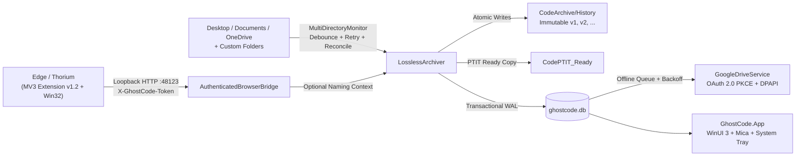

# GhostCode — Lossless Code Archiver & WinUI 3 Desktop Companion

> **Never lose another `Untitled1.cpp` solution again.**  
> Reengineered in **C# / .NET 10** with genuine **WinUI 3 (`Microsoft.WindowsAppSDK`)**, **SQLite WAL lossless versioning**, **multi-directory Desktop/Documents/OneDrive monitoring**, and **native Google Drive OAuth 2.0 PKCE + DPAPI** synchronization.

---

## Architecture



### Projects
- **`src/GhostCode.Core`**: UI-independent .NET 10 library providing Known Folder resolution, recursive multi-directory monitoring, lossless byte-preserving versioned storage in SQLite WAL, source analysis (`C`, `C++`, `Python`, `H/HPP`), authenticated loopback browser bridge, DPAPI token vault, and Google Drive v3 client.
- **`src/GhostCode.App`**: Genuine WinUI 3 (`Microsoft.WindowsAppSDK 2.6.5`) XAML application using `<MicaBackdrop />`, `NavigationView`, `SettingsCard`, `InfoBar`, `ProgressRing`, `ContentDialog`, `ToggleSwitch`, MVVM (`CommunityToolkit.Mvvm`), DI (`Microsoft.Extensions.DependencyInjection`), System Tray (`Shell_NotifyIconW`), and bilingual `Tiếng Việt` / `English` UI.
- **`tests/GhostCode.Tests`**: 30 xUnit tests across archival, monitoring, cloud/bridge security, and 18 end-to-end acceptance scenarios.
- **`browser-extension/`**: Hardened Manifest V3 extension (`v1.2.0`) for Microsoft Edge and Thorium that enforces active-tab visibility and authenticates with `X-GhostCode-Token`.

---

## Key Capabilities

- **Works With or Without Browser Context**: Saving any eligible source file (`.c`, `.cpp`, `.cc`, `.cxx`, `.py`, `.h`, `.hpp`) in any watched folder creates an immutable backup automatically, even when offline or with no browser open.
- **Zero-Data-Loss History**: Never overwrites previous backups based on heuristic code similarity; resets to empty files or boilerplate templates preserve the prior snapshot automatically.
- **Multi-Directory & OneDrive Support**: Discovers Windows Known Folders (including OneDrive-redirected Desktop/Documents) via `SHGetKnownFolderPath` without hardcoded usernames, supports unlimited custom folders, excludes output directories, and refuses full drive roots (`C:\`).
- **Native Cloud Sync**: Encrypts OAuth tokens using Windows DPAPI (`DataProtectionScope.CurrentUser`), performs remote SHA-256 deduplication via Drive `appProperties`, and retries outages with bounded exponential backoff.

---

## Quick Start

### 1. Build & Run Tests
Requires **.NET 10 SDK** on Windows x64:

```powershell
dotnet restore GhostCode.sln -r win-x64
dotnet build GhostCode.sln -c Release -p:Platform=x64 --no-restore
dotnet test GhostCode.sln -c Release -p:Platform=x64 --no-build
```

Run the packaged WinUI 3 application:
```powershell
src\GhostCode.App\bin\x64\Release\net10.0-windows10.0.19041.0\win-x64\GhostCode.App.exe
```

### 2. Google Cloud Desktop OAuth Setup (One-Time)
GhostCode never bundles hardcoded OAuth client secrets:
1. Open [Google Cloud Console](https://console.cloud.google.com/) and create or select a project.
2. Enable the **Google Drive API**.
3. Configure the **OAuth consent screen** (External/Testing — add your Google account under Test users) with scope `https://www.googleapis.com/auth/drive.file`.
4. Under **Credentials -> Create Credentials -> OAuth client ID**, choose **Desktop app**.
5. In GhostCode -> **Google Drive** tab -> click **Configure OAuth Client...**, paste your **Client ID** (and optional Client Secret), then click **Connect Google Account**.

### 3. Install the Browser Extension (Edge & Thorium)
1. Navigate to `edge://extensions` or `chrome://extensions`.
2. Enable **Developer mode**.
3. Click **Load unpacked** and select `browser-extension/`.
